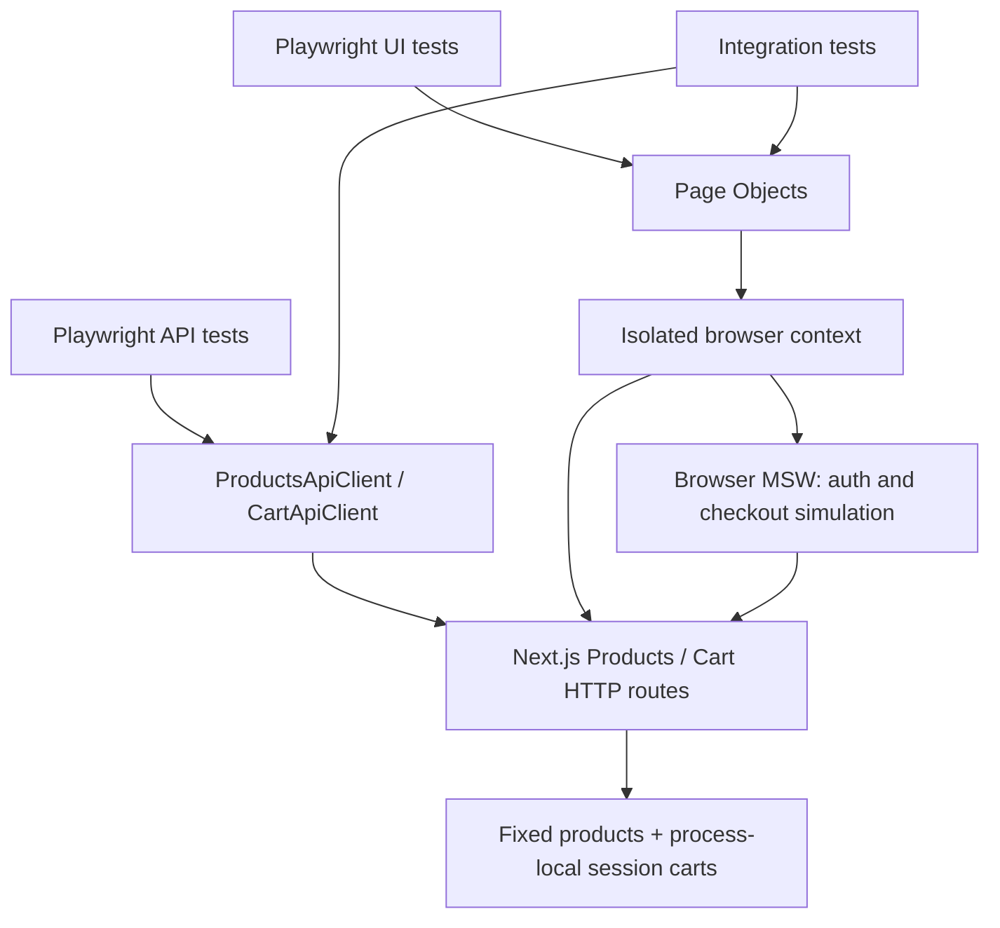

# Architecture and decisions

## Runtime boundaries

Tests assert business behavior. Page Objects expose actions and selected locators;
they do not hide assertions, retries, sleeps or network mocks. API clients return
`APIResponse` so negative tests can inspect non-2xx status codes before parsing.
Zod schemas validate untrusted JSON at the test boundary. The cart schema also
checks that total equals the sum of line totals.

## Decision 1: one portable source bundle

The application and framework remain independent npm packages with independent
lockfiles. A root package supplies convenience scripts without introducing a
workspace manager or shared production dependencies. The archive contains both
folders, so API extensions are versioned together with the tests that require them.
A single-repository workflow can check out the exact same revision.

## Decision 2: test-scoped data, not ordering

Each Playwright test receives its own request/browser context. Cart fixture setup
first establishes a session cookie with GET. In API-only tests it uses the standalone
request fixture. In integration tests it uses `context.request`, so API and UI use
the same cookie jar. Cleanup removes all positions in `finally` and checks an empty
cart before the context is disposed.

There are no dependent serial shopping tests. Every scenario prepares its own
state. Random UUID signup emails avoid collisions without randomly choosing
business expectations. Products remain deterministic; tests derive expected
names/prices/order from the Products API where the test is about consistency.

The server reads mutable cart state after awaiting JSON parsing. Otherwise two
requests starting against an empty cart could each capture a different empty array
and overwrite one another. A concurrent-additions test guards this behavior.

## Decision 3: controlled HTTP and browser mocking serve different purposes

Products and Cart are real HTTP handlers. MSW auth/checkout remain explicitly
simulated browser contracts. Playwright request contexts do not use a browser
service worker. We do not pretend a standalone checkout API exists.

Network tests use `?e2eNoMsw=1` and blocked service workers. The explicit switch
prevents MSW startup from hanging a deliberately intercepted page. HTTP 500 and
aborted requests must render an error; an empty 200 response must render an empty
catalog. Superseded catalog requests are cancelled to avoid stale response races.

## Decision 4: observability without hiding failures

`page` is overridden lazily, preserving browser-free API tests. During a UI test it
records at most 200 console warnings/errors, uncaught errors, failed requests and
HTTP error responses. Listeners are removed at teardown. The JSON is attached only
on an unexpected outcome; screenshot and trace use native Playwright retention.
No screenshot wrapper or home-grown retry library is needed.

In CI there is one worker and one retry by default. `failOnFlakyTests` turns a
retry-only success into a failed run.

## Decision 5: reproduce locally before enabling hosted execution

Configuration validates origin, browser choices, server ownership and numeric
limits before test discovery. Managed test runs default to a fresh production build, both locally and in CI.
An explicit development mode is available for debugging; it is not the release gate.
Production mode never silently reuses an unrelated server. A manually triggered GitHub Actions workflow
runs package quality gates and then API/Chromium/Firefox jobs. Report uploads are an explicit manual option, disabled by default; when
enabled, reports are retained even when tests fail. Hosted execution is not claimed until it actually runs.

## Extension boundaries

- Another application: replace Page Objects, endpoint clients, schemas and seed
  factories. Keep configuration, fixture lifecycle, reports and CI conventions.
- Another test language: port contracts and scenarios, not TypeScript syntax.
- Persistent backend: replace the process-local store with a real data-access layer;
  keep the externally observable contract and the test isolation model.
- More browsers: add a supported configured browser and install its binary. WebKit
  is available by configuration but is not in the verified release matrix.
- Real auth/checkout: implement server endpoints and persistent order contracts,
  then add true HTTP tests. Browser mock tests alone cannot validate those services.
